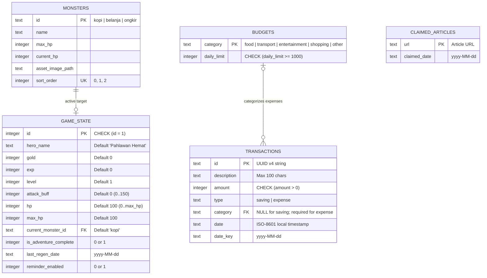
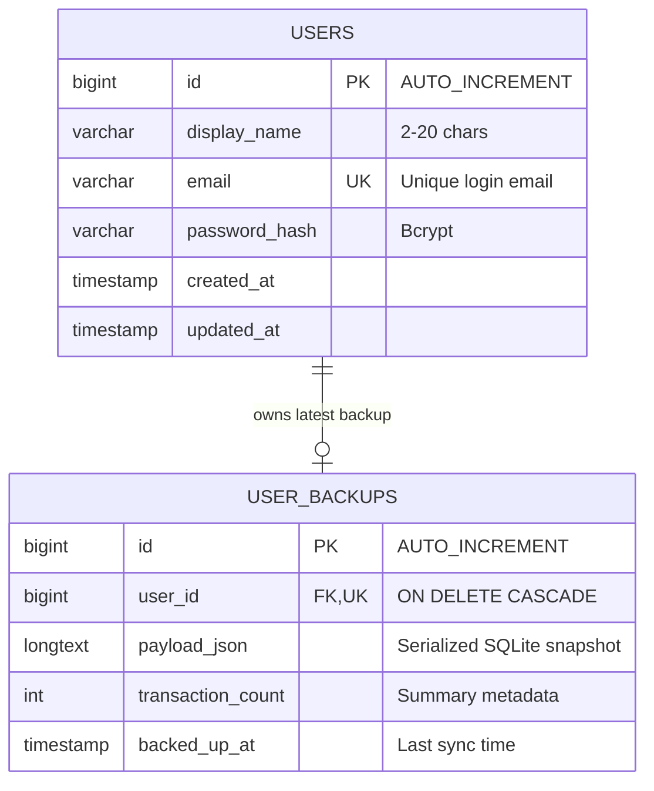

# Entity Relationship Diagram

FinQuest uses **two separate databases** with distinct roles:
1. **Local SQLite (`finquest.db`) on the device:** Primary active database for 100% offline-first gameplay and finance tracking (no login required).
2. **Server MySQL (`finquest_server`) on the laptop:** Optional cloud account and backup store served by **Express.js** for cross-device backup/restore.

---

## Part A: Local SQLite Database (`finquest.db`)

- **Engine:** SQLite via `sqflite` (`version: 1`, with `PRAGMA foreign_keys = ON`).
- **Money:** Stored as `INTEGER` (whole Rupiah).
- **Dates:** ISO-8601 strings (`date`) plus indexed local day key `yyyy-MM-dd` (`date_key`) for fast daily budget aggregation.

### Relationship & Design Notes

1. **`MONSTERS ||--o| GAME_STATE`:** `game_state.current_monster_id` references `monsters.id` to explicitly track the active boss. When the active monster is defeated, `GameStore` advances `current_monster_id` to the monster with the next `sort_order` (or sets `is_adventure_complete = 1` on the last monster).
2. **`BUDGETS |o--o{ TRANSACTIONS`:** Every `expense` transaction references one of the 5 fixed categories in `budgets`; `saving` transactions store `category = NULL`.
3. **Standalone `claimed_articles`:** Because `finquest.db` is a single-user local database, `claimed_articles` intentionally has no foreign key—it acts purely as a local deduplication log to enforce the "once ever per URL" and "max 3 articles/day" rules.

### SQLite Constraints & Indexes

| Table | Constraint / Index | Purpose |
| :--- | :--- | :--- |
| `game_state` | `CHECK (id = 1)` | Enforces single-row profile on device |
| `game_state` | `FOREIGN KEY (current_monster_id) REFERENCES monsters(id)` | Ensures active battle target always points to a valid monster |
| `transactions` | `CHECK ((type = 'expense' AND category IS NOT NULL) OR (type = 'saving' AND category IS NULL))` | Matches `TransactionRecord` Dart invariant |
| `transactions` | `INDEX idx_transactions_daily ON transactions(date_key, category)` | Fast `SUM(amount)` for today's budget bars & overage check |
| `transactions` | `INDEX idx_transactions_date ON transactions(date DESC)` | Fast latest-100 History query |

---

## Part B: Server MySQL Database (`finquest_server` — Laptop)

- **Engine:** MySQL 8+ (served by Express.js + `mysql2`).
- **Design choice:** Each user stores one latest backup snapshot (`user_backups.payload_json`) containing the serialized SQLite tables. This guarantees atomic backup/restore with zero merge conflicts.

---

## Enum & Code Reference

| Column | Allowed Values | UI Label (Indonesian) |
| :--- | :--- | :--- |
| `transactions.type` | `saving` | Tabungan |
| `transactions.type` | `expense` | Pengeluaran |
| `budgets.category` / `transactions.category` | `food` | Makan |
| | `transport` | Transportasi |
| | `entertainment` | Hiburan |
| | `shopping` | Belanja |
| | `other` | Lainnya |
| `monsters.id` | `kopi` | Monster Kopi Susu Mahal (300 HP) |
| | `belanja` | Monster Belanja Impulsif (800 HP) |
| | `ongkir` | Monster Ongkir Makanan (1500 HP) |