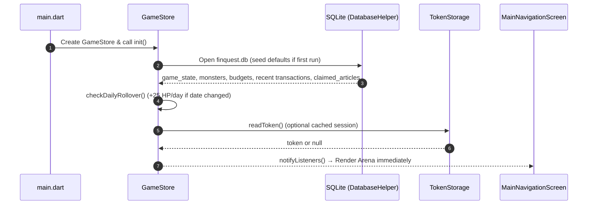
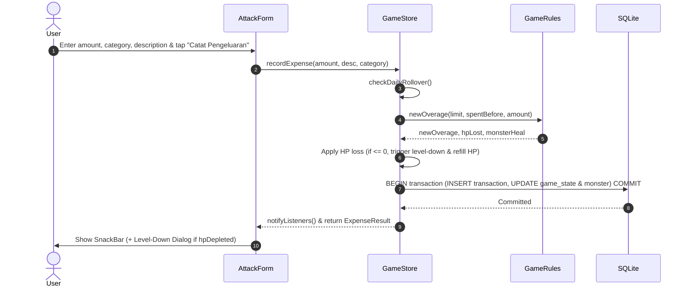
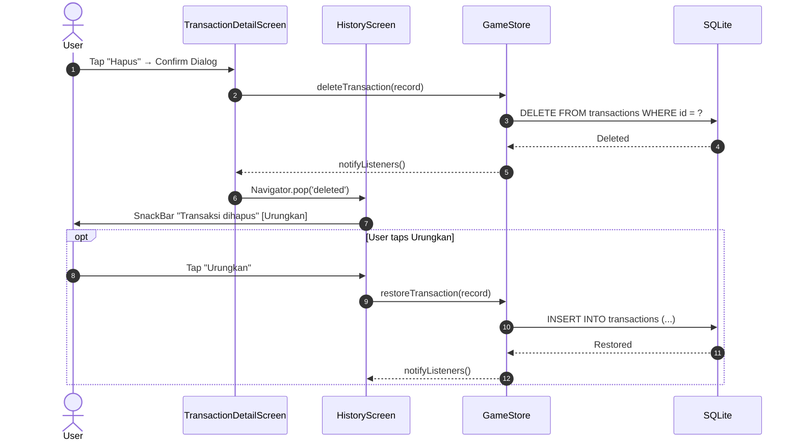
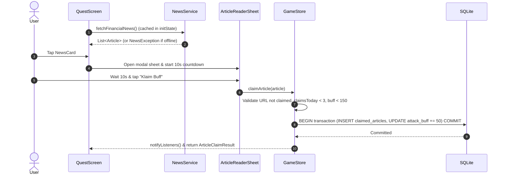
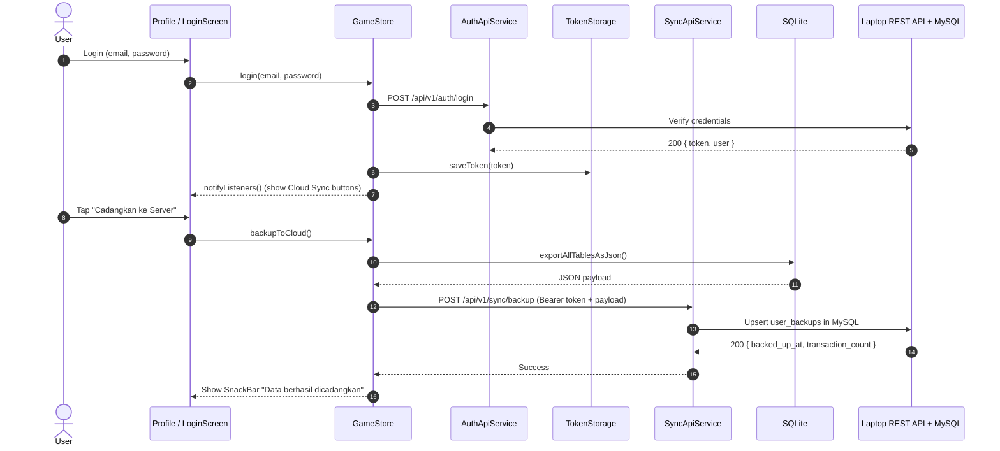
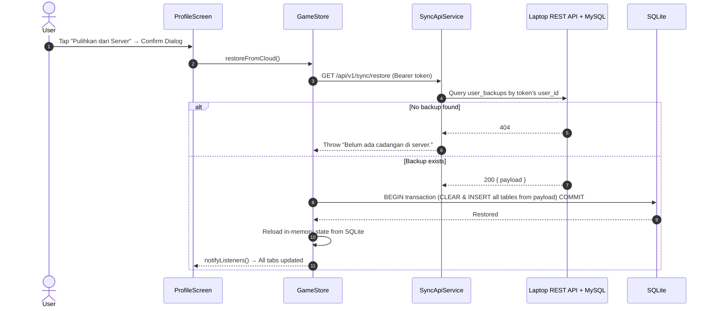

# Sequence Diagrams

Target execution flows for FinQuest v6.0 (**SQLite Offline-First** + **Optional MySQL REST Sync**).

## 1. App Startup (Offline-First, No Login Required)

## 2. Record Expense & Budget Survival (100% Offline)

## 3. Transaction Delete & Undo (100% Offline)

## 4. Daily Mission — Read News & Claim Buff

## 5. Optional Login & Manual Cloud Backup (Laptop MySQL)

## 6. Manual Cloud Restore (New Device / After Reinstall)

